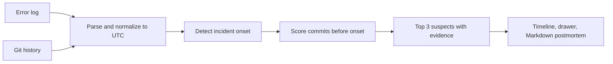
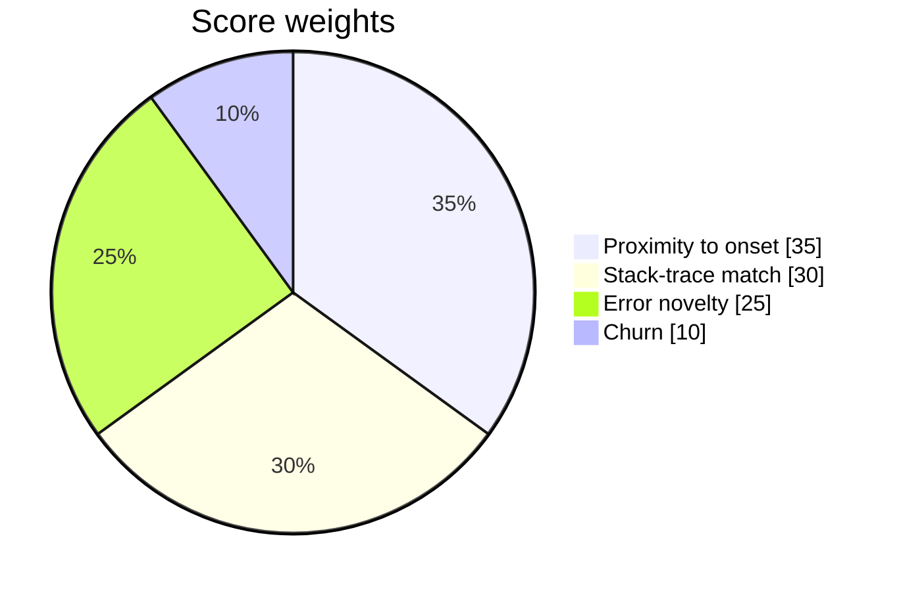

# Culprit

Which commit most likely broke production? Give Culprit an error log and a git-history export. It detects when the errors began and ranks the suspect commits with evidence you can verify. Everything runs in your browser, with no server and no network.



## Privacy and local boundary

Logs and repository history never leave the page. Nothing is uploaded, stored remotely or sent to a service, and there are no runtime network calls. No secrets are needed (`.env.example` documents this).

## Quick start

Requires the pinned Node 22.20.0.

```sh
nvm use
npm ci
npm run dev
```

| Command | Purpose |
|---|---|
| `npm run dev` | Start the dev server |
| `make test` | Typecheck, run the test suite, build (offline) |
| `npm run build` | Production build into `dist/` |
| `npm run preview` | Serve the build locally |

Without `make`, run `npm run typecheck && npm test && npm run build`.

### Docker

```sh
docker build --tag culprit:phase1 .
docker run --rm --publish 4173:4173 culprit:phase1
```

Then open http://localhost:4173. The image serves the static build as a non-root user with a strict Content-Security-Policy (`connect-src 'none'`).

## Using the console

Open the console and pick one of three bundled incidents; one click analyzes it.

| Case | What it shows |
|---|---|
| Checkout outage | A sharp spike with a clear culprit |
| Slow burn | A gradual ramp |
| Ambiguous | No clear culprit, reported honestly |

To use your own data, choose "Use your own files" and supply a log and a history export (pick, drop or paste). The cap is 1 MiB of log text, 10,000 events and 100 stack lines per event. Every control works from the keyboard. Fonts are system stacks by default; see `FONTS.md` in `src/assets/fonts` to bundle Inter or Geist locally.

## Input formats

- **JSON-lines logs**: one object per line with an ISO-8601 `timestamp` (with `Z` or an offset) and a `message` or `error`.
- **Plain-text logs**: `<ISO timestamp> <level> <message>`, where the level is lowercase. Indented lines, `at ...` frames and `Caused by:` lines attach to the event above.
- **History**: the versioned `culprit-json` object `{ "schemaVersion": 1, "format": "culprit-json", "repository", "commits": [...] }`. Raw `git log` output is not accepted.

The hosted-demo input cap is stated above. Over-limit input is reported, never silently accepted.

## How ranking works

A frozen, explainable heuristic (`scoring-v1`): no model, no randomness and no clock. Only commits at or before the onset are eligible.



Each signal is 0 to 1. The report shows every value, weight and contribution, and the contributions add up to the score. Ties break by trace match, then the newer commit, then SHA. Scores are ranked suspicion, not probability or proof. Low-confidence outcomes such as `ambiguous` and `no-clear-culprit` are valid results and are shown explicitly.

## UTC and determinism

All timestamps are normalized and displayed in UTC. Identical inputs give byte-identical JSON and Markdown, with no current time, randomness, locale formatting or machine-specific paths. The tests pin SHA-256 fingerprints of the bundled outputs.

## Project layout

```
src/core     parser, onset detection, ranking, serialization (pure)
src/ui       console views and view models
src/worker   analysis worker with a main-thread fallback
fixtures     the three bundled incidents
scripts      production static server, near-cap input generator
tests        Vitest suite (runs offline)
```

## Limitations

Culprit narrows an investigation; it does not establish causality, roll back code or replace human review.

- Only the top application frame of each error is scored; vendor, runtime and build-output frames are not matched.
- Event timestamps are trusted; there is no clock-skew correction.
- Timelines over 10,000 buckets are rejected. Long lists render 100 rows at a time.
- A near-cap input (about 1 MB, 9,990 events) analyzed in roughly 0.3 s in headless Chrome on one machine. Treat this as a single measurement, not a guarantee.
- The `/` shortcut cannot be turned off (WCAG 2.1.4); Ctrl or Cmd+K and the visible button do the same thing.
